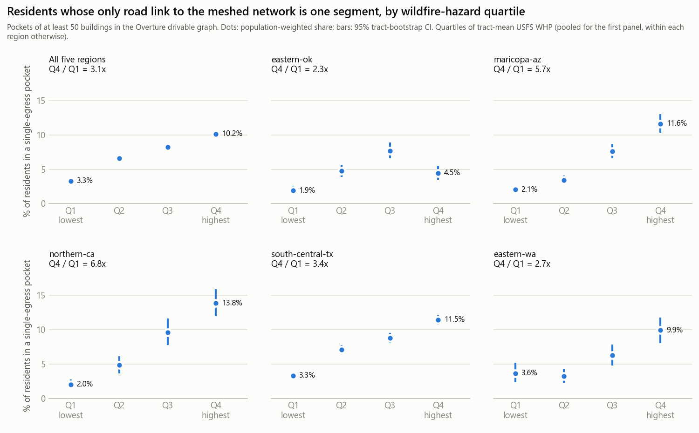
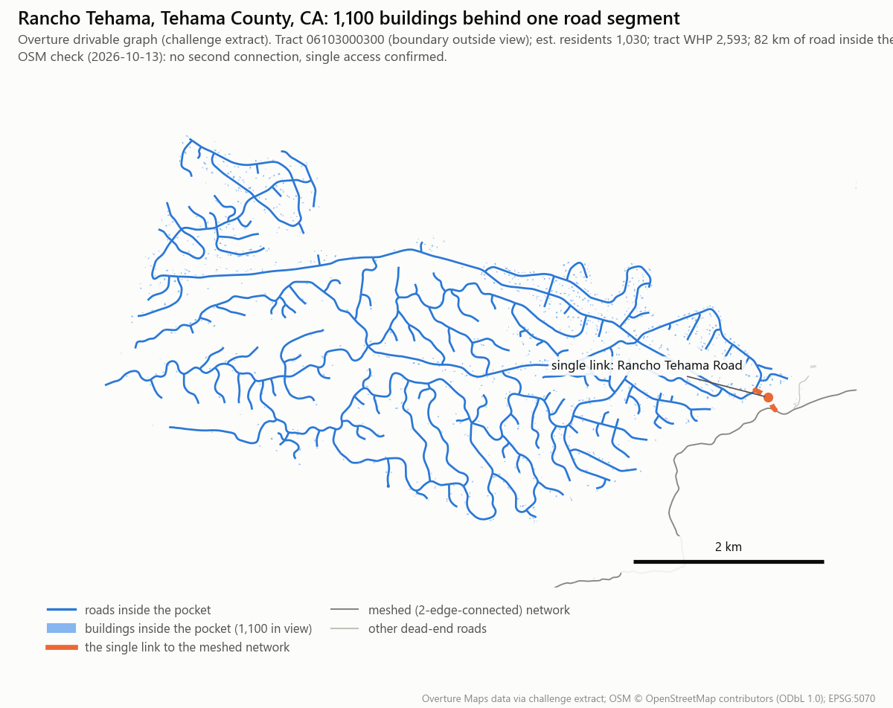
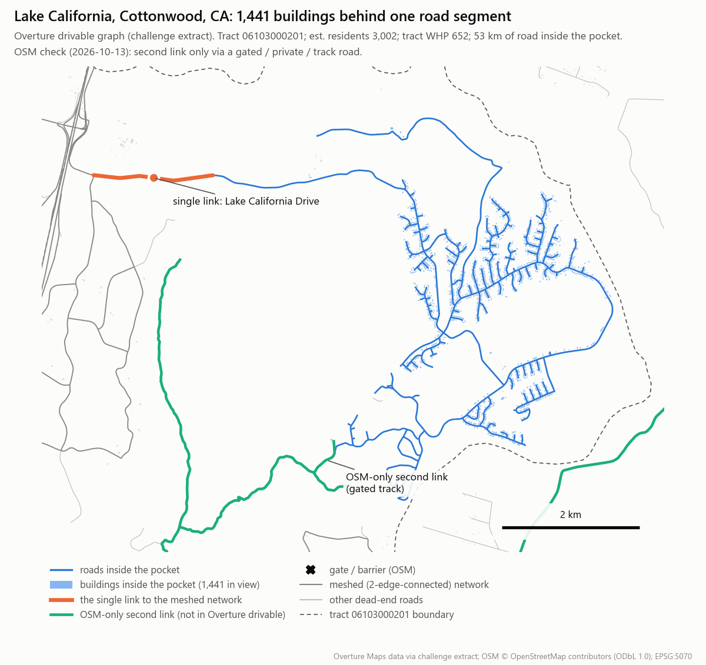
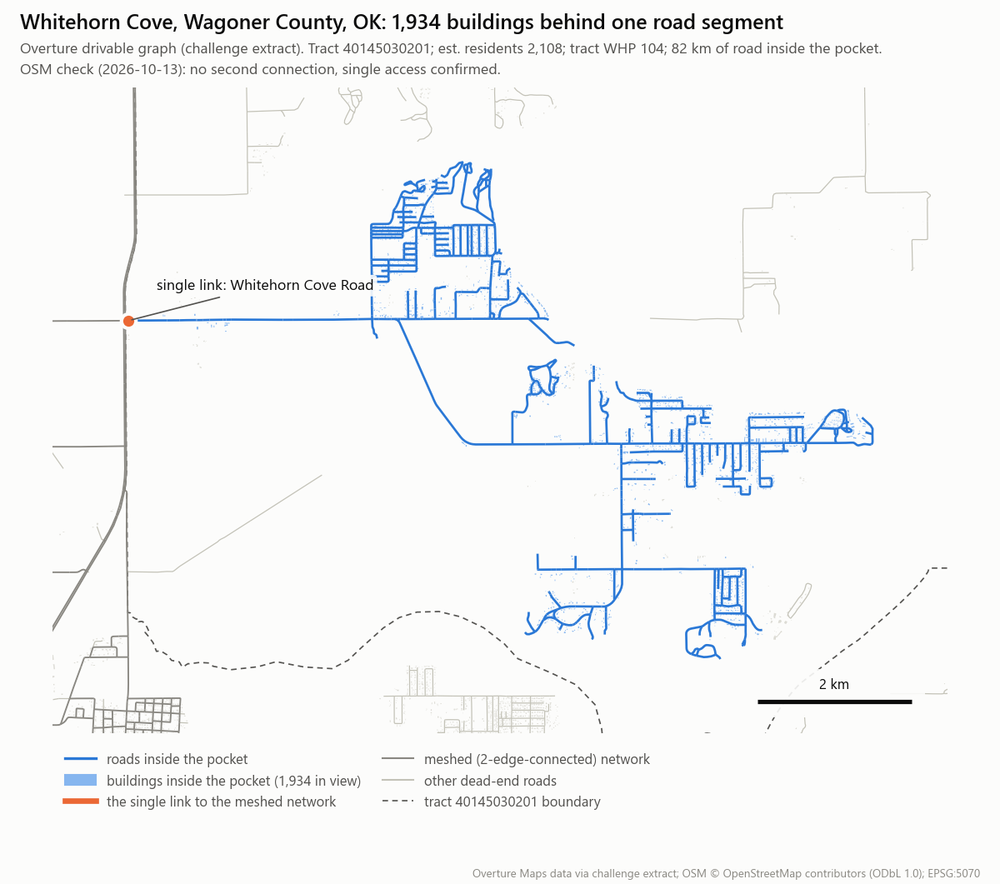

# One road out: wildfire-country communities depend on a single road segment in Overture's road graph, and the coverage scorecard cannot see it

**Best Bias Discovery submission: Bias Bounty Mapping Equity Challenge** (Zindi team resist)

Data: the challenge's own Overture extracts and strata tables for the five regions. Two additional public sources
are used, as the rules allow for this prize: current OpenStreetMap through the public Overpass API, for validation
only (§4.10, ODbL), and U.S. Census ACS 2024 5-year tract tables, to describe who lives in the pockets (§4.11,
public domain).

Code and outputs: `discovery/` (scripts `01`–`18`, results in `discovery/out/`, figures in `discovery/figs/`).

---

## 1. The finding in brief

We built the routable road network that Overture itself defines: drivable segments joined where they share a `connector_id`. In that network, **2.88 million residents (7.1% of the five regions, 95% CI 6.9–7.4%) live in 13,775 "pockets"** of at least 50 buildings whose *only* connection to the meshed network is one road segment. Remove that segment (a fire front, a crash, a washout) and the whole pocket is cut off in the graph.

**That dependence is concentrated where wildfire hazard is highest:**

| | Lowest wildfire-hazard quartile (Q1) | Highest quartile (Q4) | Q4 vs Q1 |
|---|---|---|---|
| Residents living in a single-egress pocket | 3.28% (2.96–3.59) | **10.15% (9.68–10.65)**, about 1.0 M people | **3.10x (2.35–4.63)**, +6.9 pp; 3.31x (2.29–4.87) adjusted for region × rural class; 5.25x (3.82–7.27) between tracts of the same county; 1.71x (1.23–2.52) also within density terciles. County-block CIs |
| Same, quartiles defined within each region | 2.90% | 10.87% | **3.75x (3.35–4.20)** |
| Residents of whole settlements with exactly one exit | 0.013% | 0.62% (0.51–0.74) | ~48x (lower bound 15x); 4.2x (3.1–5.8) vs Q1–Q3 |
| Care homes behind one segment | 0.94% | **4.56%** | 4.9x |
| Fire / EMS / police / hospitals behind one segment | 0.53% | **3.18%** | 6.0x |
| Schools and child care behind one segment | 0.67% | **2.42%** | 3.6x |

*Hazard is the tract-mean USFS Wildfire Hazard Potential (WHP, strata column `usfs_WHP_mean`). Rates are population-weighted. The CIs of the rates and of the facility ratios come from a tract bootstrap (B = 2000; facility CIs are Wilson intervals in §4.6). The CIs of the headline residents ratio come from a county-block bootstrap (counties resampled within region, §4.3), which is wider because pockets cluster spatially. The adjusted ratios are Mantel–Haenszel estimates over region × rural strata, and over region × rural × density-tercile strata (§4.3).*

- **Q4 exceeds Q1 inside every region**, using within-region quartiles: eastern-ok 2.3x, eastern-wa 2.7x, south-central-tx 3.4x, maricopa-az 5.7x, northern-ca 6.8x. Every 95% CI excludes 1. Q4 vs Q1–Q3 (pooled quartiles) is not uniform: eastern-ok shows no excess (0.87x, 0.66–1.11; its Q3 is highest), the other four regions range from 1.66x to 3.95x. In eastern-ok the Q4 vs Q1 gradient also disappears once rural and urban tracts are compared separately (1.00x rural, 1.08x urban; `out/adjusted_ratios.csv`), so there it reflects rurality.
- **Hazard overlaps rurality (§4.4).** Inside rural tracts, WHP Q4 vs Q1–Q3 is 0.96x (0.85–1.09): there, hazard adds little beyond rurality. Inside urban-classified tracts (the wildland–urban fringe) Q4 vs Q1 is still 2.96x.
- **The drivable `roads` layer makes it worse in fire country.** For 17.5% (15.8–19.2%) of Q4 pocket residents, a second connection does exist in Overture, but only as `service`, `track`, `living_street` or `unknown` segments. The filtered layer drops those classes. In Q1–Q3 the figure is 12.4% (11.3–13.6%).
- **A coverage gap the scorecard does not measure.** No metric counts redundant egress, the property that matters for evacuation. Rancho Tehama's tract has 1,247 km of mapped road, and 82 km of it sit behind a single segment. Road length does not track pocket share consistently (§4.12): Spearman(pocket share, km per 1,000 residents) is +0.28 over all tracts, 0.006 (p = 0.78) inside WHP Q4 and −0.33 inside rural tracts. 99.3% of pocket residents depend on a link below `secondary` class (86% on a `residential` segment), outside the transport metric.
- **Pocket residents are older, not poorer in cars or English (§4.11, ACS 2020–2024).** 16.8% are 65+ against 15.1% of all residents (1.12x, 1.06–1.19; 1.10x within the same region × rural class), about 486,000 people. They are less often without a vehicle (0.72x) or limited-English (0.82x). Tract-level estimate.
- **Checked against current OpenStreetMap (§4.10).** In a seeded random sample of high-hazard pockets, 29 of 33 resolved (88%, Wilson CI 72–95%; 90% resident-weighted) have no public second road in OSM either, so the exposure is real-world. About 1 in 8 (12%, CI 5–27%) is an Overture gap: a junction or a public service road missing from the drivable layer. Of the 16 named communities, 12 have no public second road in OSM; 4 have a public service road that Overture's drivable layer lacks. Even if 27% of WHP-Q4 pockets (the upper CI) were such gaps and none in Q1, Q4 vs Q1 would still be 3.10 × 0.73 ≈ 2.3x.
- **Official public-road inventory (§4.10, FHWA HPMS 2024): an upper bound.** 31 of 33 random high-hazard pockets (94%, Wilson CI 80–98%) and all 16 named communities have no second exit over a road HPMS lists as public. HPMS omits public service roads, so it counts the 4 OSM service-road exits above as non-public; its agreement with OSM on "public second exit, yes/no" is weak (kappa 0.36).




---

## 2. Impact: what this means in the named places

A dispatch or routing engine built on Overture `roads` (OSRM, Valhalla, GraphHopper, or a county CAD import) treats each pocket below as reachable through one segment. If that segment is blocked, the graph has *no* alternative route. An evacuation-clearance model built on the same graph loads every resident onto that one link.

- **Rancho Tehama, Tehama County, CA (tract 06103000300; WHP 2,593, Q4; CDC Social Vulnerability Index (SVI) 0.72).** 1,100 buildings (~1,030 residents est.) and 82 km of internal road hang off one segment of *Rancho Tehama Road*. Inside sit **Rancho Tehama Elementary School** and a preschool. Even the unfiltered layer offers no second connection. One blocked segment isolates a school and about a thousand people in the region's highest-hazard class.
- **Lake California, Cottonwood, CA (06103000201; WHP 652).** 1,441 buildings (~3,000 residents est.) sit behind *Lake California Drive*, and so does **Tehama County Fire Station 2**. The station's route out to the wider area and the community's evacuation route are the same segment.
- **Olympic Valley, Placer County, CA (06061022014; WHP 1,497).** 827 buildings, the **Olympic Valley Fire Department**, **Creekside Charter School** and three other schools all depend on *Olympic Valley Road* in the drivable layer. A second connection exists in Overture only as service/track segments: invisible to any tool that loads `roads`, and of unknown evacuation grade.
- **Chelan and Kittitas counties, WA (very high-hazard canyons).**
  - *Icicle Road* (53007960201, WHP 2,773): 372 buildings.
  - *Stirrup Road*, Leavenworth (53007960202, WHP 11,564): 355 buildings.
  - *Casassa Road*, Cle Elum (53037975201, WHP 13,886): 436 buildings.
  - *Salmon la Sac Road* (53037975101): 434 buildings and 110 km of road behind one segment.
- **Tribal lands, Oklahoma.**
  - **Whitehorn Cove**, Wagoner County (40145030201, Cherokee OTSA, i.e. Oklahoma Tribal Statistical Area): 1,934 buildings and **Whitehorn Cove Fire And Rescue** behind *Whitehorn Cove Road*.
  - **Basin Road**, Mannford (40037020706, Creek OTSA): 1,252 buildings, **Basin Fire Department** and two child-care sites.

  Neither has a second link even in the unfiltered layer, and both are WHP Q4. In tracts flagged `tribal_any`, residents are 2.5x (1.5–3.8x) as likely as elsewhere to live in a *whole settlement* with a single exit.
- **Hurricane coast, TX (disaster relief).**
  - **Sargent** (48321730503): 2,797 buildings and the **Sargent Volunteer Fire Department** behind *FM 457*.
  - **Port O'Connor** (48057000501): a whole settlement of 2,833 buildings with one exit, even when service and track roads are added. The pocket behind *SH 185 E* holds 2,970 buildings: it also counts outlying buildings on the pocket's roads that fall outside the settlement's 200 m grid cells.

  One washout on such a link isolates the whole town in the graph, so relief routing has nothing to fall back on.







Those are the people who most need two ways out (high wildfire hazard). They are three to four times as likely to have one way out in the map. For one in six of them (17.5%), a second way exists only in a road class the drivable product throws away.

**Policy relevance: the list California's SB 99 asks for.** SB 99 (Chapter 202, Statutes of 2019) amended Government Code §65302(g): at the next housing-element revision, each California city and county must update its safety element to identify residential developments in hazard areas that do not have at least two emergency evacuation routes ([bill text](https://legiscan.com/CA/text/SB99/2019), retrieved 2026-10-16). Cities have met this with one-off consultant studies, for example Berkeley's *Access Impaired Neighborhood Analysis* ([report](https://berkeleyca.gov/sites/default/files/documents/Access%20Impaired%20Neighborhood%20Analysis%20-%20SB%2099%20Report.pdf), retrieved 2026-10-16). The state's planning advisory on the method was still a public-comment draft in October 2023 ([LCI announcement](https://lci.ca.gov/newsroom/news/2023/10-05/)). For the six fire-corridor counties in this challenge we found no published list (§4.10). The pocket metric is a reproducible, open-data first pass at exactly that list, and §5b gives it per county. Washington, Oklahoma, Arizona and Texas have no equivalent mandate, but the same list serves their evacuation and dispatch planning.

---

## 3. Novelty: outside the scorecard and outside the predefined strata

- **A coverage gap no length or count metric can see.** The scorecard asks how much road is mapped. Evacuation needs to know how many independent ways out there are. In pocket tracts the first answer is "plenty": Whitehorn Cove's tract has 164 km of road, of which only 1.0 km is a class the transport metric counts. The second answer is "one". Topology is the missing dimension, and the drivable-class filter makes it worse.
- **Not one of the five scorecard metrics.** Transport length, building count, facilities, establishments and the composite are per-tract counts or lengths. All are unchanged by how roads connect. A tract can score a perfect transport ratio while 1,100 of its buildings hang off one segment. The pocket metric reads Overture's own topology (`connectors`), which no scorecard component inspects.
- **A new unit of analysis.** The pocket (exact single-egress set) and the settlement (max-flow exit count) are network-defined, sub-tract communities. They are named with Overture's own POIs and road names rather than with predefined strata. The predefined strata are used only to *compare* them.
- **A product-level bias.** Choosing the drivable `roads` file over `roads-unfiltered` silently removes second exits for 14.1% (13.2–15.1%) of pocket residents, and more in fire country (17.5%). It also creates 9,138 of the 9,283 interior "routing islands", those that reconnect through service or track roads (§4.7).
- **Related work.** StreetLight Data's 2019 study ranked the 100 US towns under 40,000 residents whose daily trips depend most on one main exit ([StreetLight Data, 26 Aug 2019](https://www.streetlightdata.com/bloomberg-streetlight-data-evacuation-risk-study/); [KQED, 14 California communities](https://kqed.org/science/1946668/data-pinpoints-14-california-communities-with-most-limited-emergency-escape-routes)). It used proprietary smartphone and vehicle GPS trips, worked at town level and, by its CEO's account, left natural hazards out. Ours uses open data only, works at the level of sub-tract pockets in every settlement size, stratifies by wildfire hazard, and shows that the map product itself (the drivable-layer filter) hides exits.

---

## 4. Evidence

### 4.1 Definitions (all from challenge files)

- **Graph.** Nodes are Overture connectors. Edges are the pieces of each drivable segment (motorway, trunk, primary, secondary, tertiary, residential, unclassified) between consecutive connectors, ordered by `at`. Segments are joined only where they share a `connector_id`, so grade separations are respected.
  - Lengths use EPSG:5070.
  - The extended graph adds `service`, `track`, `unknown` and `living_street` from `-roads-unfiltered`.
  - **"Second connection exists"** means that more than 50% of the pocket's nodes join the core of the extended graph (`ext_core_share > 0.5`, `02_egress.py`). At or below 50% the pocket still counts as single-egress; §5 reports the share as "partial (x%)".
- **Clip-edge handling.** A virtual OUT node is joined to every connector within 100 m of the region outline (or outside it). Roads that leave the extract therefore count as possible exits, which is conservative.
  - Pockets whose only link is the virtual OUT edge are excluded: their exit leaves the data (7 pockets).
  - This rule was added after an artefact was found: Bingen, WA first appeared as a pocket because neighbouring White Salmon's tract is not in the region.
- **Core and pocket.**
  - The core is the largest 2-edge-connected component, computed after removing all bridges (iterative Tarjan on the multigraph; `discovery/test_bridges.py` checks it against brute force).
  - A pocket is a connected set of non-core nodes. By construction it attaches to the core by exactly **one** edge.
  - Buildings (bbox centre of each Overture footprint) attach to the graph edge of their nearest drivable segment within 150 m.
  - A pocket counts if it holds ≥ 50 buildings.
- **Settlement exits.** Buildings are gridded at 200 m. Cells with ≥ 2 buildings are 8-connected into settlements, and settlements with ≥ 50 buildings are kept.
  - Exits = unit-capacity max-flow (edge-disjoint paths) from the edges the settlement's buildings attach to, to core nodes more than 3 km from every settlement cell. The computation runs in a 10 km window; roads leaving the window or the region count as exits.
  - Settlements where fewer than 50% of buildings attach to a drivable segment are reported separately as "unmapped" (e.g. a 4,585-footprint site near Marana with almost no mapped streets).
- **Residents.** Tract `pop_total` × the pocket's share of the tract's buildings.
- **Strata** (all from `<region>-strata-tract-table.parquet`):
  - `usfs_WHP_mean` quartiles, pooled (cut points 6.45 / 25.47 / 71.41) and within region;
  - `ur_class`;
  - `tribal_any` / `aiannh_name`;
  - `svi_overall` and `svi_housing_transport`, fixed quintiles of the national rank.

### 4.2 Per region

| Region | Pockets ≥ 50 bldgs | Buildings | Residents (est.) | Share of population | WHP Q4 vs Q1 (within-region quartiles) | Second link only via service/track | Pockets explained by a connector near-miss | One-exit settlements / residents |
|---|---|---|---|---|---|---|---|---|
| eastern-ok | 1,313 | 130,025 | 189,441 | 4.82% (4.35–5.30) | 2.34x (1.61–3.56) | 8.8% | 0.5% | 83 / 15,584 |
| eastern-wa | 701 | 74,266 | 92,992 | 5.55% (4.81–6.29) | 2.72x (1.82–4.28) | 19.6% | 0.9% | 42 / 4,648 |
| maricopa-az | 2,074 | 230,908 | 406,092 | 6.15% (5.66–6.65) | 5.67x (4.43–7.51) | 25.3% | 0.6% | 94 / 16,654 |
| northern-ca | 960 | 100,149 | 181,631 | 7.39% (6.57–8.31) | 6.79x (4.86–10.15) | 23.6% | 1.0% | 43 / 9,068 |
| south-central-tx | 8,727 | 1,027,537 | 2,013,883 | 7.82% (7.50–8.15) | 3.45x (3.02–3.98) | 11.3% | 0.4% | 326 / 59,852 |
| **All** | **13,775** | **1,562,885** | **2,884,039** | **7.13% (6.89–7.40)** | **3.75x (3.35–4.20)** | **14.1%** | 0.4–1.0% | **588 / 105,807** |

Region rows are rounded; their residents sum to 105,806.

"Connector near-miss" means a dead end of the pocket lies within 10 m of another drivable segment with no shared connector. These defects explain about 1% of pockets (0.4–1.0% by region), so pockets are not an artefact of broken connector topology.

### 4.3 Comparisons across strata (residents in pockets ≥ 50 buildings; pooled over regions)

| Comparison | Rate A | Rate B | Ratio (95% CI) | Difference |
|---|---|---|---|---|
| WHP Q4 vs Q1 (pooled quartiles) | 10.15% | 3.28% | **3.10 (2.80–3.48)** | +6.87 pp (6.30–7.46) |
| WHP Q4 vs Q1 (within-region quartiles) | 10.87% | 2.90% | **3.75 (3.35–4.20)** | +7.97 pp |
| WHP Q4 vs Q1–Q3 | 10.15% | 6.16% | 1.65 (1.54–1.75) | +3.99 pp |
| Rural vs urban | 11.02% | 6.40% | **1.72 (1.61–1.84)** | +4.62 pp (3.95–5.29) |
| Tribal vs non-tribal (pooled) | 5.22% | 7.28% | 0.72 (0.63–0.81) | −2.07 pp |
| SVI Q5 (most vulnerable) vs Q1 | 5.16% | 8.93% | 0.58 (0.52–0.64) | −3.77 pp |
| *Still single-egress with service/track added:* WHP Q4 vs Q1 | 8.38% | 2.93% | 2.86 (2.56–3.23) | +5.45 pp |

**Adjusted for region and rural class, with county-block CIs** (`14_adjusted.py`). The crude ratio mixes regions, and the tract bootstrap ignores spatial clustering. We pool Q4 vs Q1 over strata with a Mantel–Haenszel (MH) rate ratio: pocket residents are the events, residents the denominator. As a check we fit a Poisson log-linear model with stratum and quartile terms. The CIs resample the 325 counties with replacement within each region and keep all their tracts (B = 2000, seed 20261014).

| WHP Q4 vs Q1, residents in pockets ≥ 50 buildings | Pooled quartiles | Within-region quartiles |
|---|---|---|
| Crude | 3.10 (2.35–4.63) | 3.75 (2.81–5.32) |
| MH, adjusted for region | 3.25 (2.37–4.72) | 3.74 (2.72–5.22) |
| MH, adjusted for rural class | 2.93 (2.16–4.50) | 3.53 (2.57–4.97) |
| **MH, adjusted for region × rural class** (10 strata, 9 with Q1 and Q4) | **3.31 (2.29–4.87)** | 3.48 (2.45–4.97) |
| Poisson, region × rural class | 3.32 (2.30–4.84) | 3.36 (2.44–4.71) |
| Still single-egress with service/track added, MH region × rural class | 3.32 (2.25–5.15) | 3.46 (2.36–5.26) |
| MH, region × rural class × density tercile (26 strata, 18 with Q1 and Q4) | 1.71 (1.23–2.52) | 1.83 (1.28–2.73) |
| Poisson, region × rural class × density tercile | 1.68 (1.16–2.70) | 1.79 (1.29–2.78) |
| MH, within county (325 strata, 56 with Q1 and Q4) | 5.25 (3.82–7.27) | 5.64 (4.73–7.06) |
| MH, within county × rural class (516 strata, 42 with Q1 and Q4) | 5.18 (3.78–6.99) | 5.40 (4.46–6.84) |

- **Region and rural class do not explain the gradient: 3.10x crude, 3.31x adjusted.** Adjusting for rural class alone gives 2.93x. Every lower limit in the first six rows is above 2.
- **Urban form explains about half of it, not all.** Density terciles are residents per km² of land (strata `ALAND`), cut within each region. Comparing tracts of the same region, rural class and density tercile, Q4 still has 1.71x (1.23–2.52) the pocket share of Q1. Density partly lies on the causal path: wildland-fringe subdivisions are low-density by design, so this row is a lower bound on the hazard gradient rather than a better estimate of it.
- **Not a between-county contrast.** Comparing only tracts of the same county, Q4 has 5.25x (3.82–7.27) the pocket share of Q1; within county × rural class, 5.18x (3.78–6.99). The 56 counties that have both Q1 and Q4 tracts hold 70% of Q1 and 55% of Q4 residents, in all five regions. The ratio is larger than the crude one because inside a county the low-hazard tracts are the urban core and the high-hazard ones its fringe, so this row does not control for density (the row above does). It rules out one explanation: the gradient does not come from some counties mapping or building roads differently. No Poisson fit here (one dummy per county is too slow to refit 2000 times).
- **County blocks widen the interval, mostly because of Houston.** Harris County holds 30.9% of pooled-Q1 residents. Resampling only south-central-tx counties gives 2.42–4.41 for the crude ratio. Resampling only one other region's counties gives at most 2.80–3.52 (maricopa-az).
- **The adjusted ratio rests on urban-classified strata.** They carry 95% of the MH weight; south-central-tx urban alone carries 68%. Rural strata hold only 20 Q1 tracts, and northern-ca has none (§4.4). Outside eastern-ok, the stratum ratios (pooled quartiles) run from 1.56x (eastern-wa rural) to 6.33x (maricopa-az urban). In eastern-ok the gradient vanishes once rural and urban tracts are separated: 1.00x rural, 1.08x urban (0.46–2.39). With within-region quartiles its urban stratum gives 1.68x (0.68–8.67), and no rural tract falls in its Q1. Its region-level 2.34x (§4.2) therefore mostly reflects the rural–urban contrast.

**Whole settlements with exactly one exit** (588 settlements, 105,807 residents):

| Comparison | Rate A | Rate B | Ratio (95% CI) |
|---|---|---|---|
| WHP Q4 vs Q1–Q3 | 0.62% | 0.15% | 4.23x (3.09–5.82) |
| WHP Q4 vs Q1 | 0.62% | 0.013% | 48x (CI unbounded above; lower bound 15x) |
| Rural vs urban | 1.18% | 0.086% | 13.7x (9.8–19.7) |
| Tribal vs non-tribal | 0.59% | 0.24% | 2.48x (1.49–3.76) |

Settlements with at most two exits: WHP Q4 2.57% vs Q1–Q3 0.53% (4.8x, 4.0–5.9).

### 4.4 Is it hazard or rurality? (honest decomposition)

- **Inside rural tracts, hazard adds little.** Within rural tracts, WHP Q4 vs Q1–Q3 is 0.96x (0.85–1.09), so there is no measurable hazard gradient beyond rurality there (Q4 vs Q1 is 2.09x, 1.15–5.72, but on only 20 rural Q1 tracts).
- **Hazard still matters inside urban-classified tracts** (the wildland–urban fringe). There WHP Q4 vs Q1 is 2.96x (2.62–3.32) and Q4 vs Q1–Q3 is 1.68x (1.54–1.84).
- So the hazard disparity is the overlap of two things: rural road trees, and fringe subdivisions with a single entrance built into fire-prone land. Both put single-link dependence where fire hazard is.
- **The rural–urban gap replicates in every region:** 1.56x to 2.36x, all CIs above 1.
- **Not a poverty pattern.** Pockets are *less* common in the most socially vulnerable tracts (SVI Q5 vs Q1: 0.58x). Gated, lakefront and exurban subdivisions are typically single-entrance. We report this inverse result as found.
- **Tribal.** The pooled tribal rate is lower (0.72x) because 805 of the 874 tribal tracts are in Oklahoma, nearly all in OTSAs that also cover urban areas. Within Oklahoma it is 1.01x (0.81–1.24); in Arizona 1.84x (1.08–2.77). At the settlement level tribal tracts are 2.48x.

### 4.5 Robustness

| Variant | WHP Q4 vs Q1 |
|---|---|
| Buildings instead of residents (no population allocation) | 3.10x (2.73–3.50) |
| Pockets of ≥ 100 buildings (pooled quartiles) | 3.92x (3.32–4.65) |
| Pockets of ≥ 100 buildings (within-region quartiles) | 5.16x (4.39–6.23) |
| Single-egress even with service/track added | 2.86x (2.56–3.23) |

Determinism: graph construction breaks ties between connectors at the same `at` by connector index. The random draws are seeded (tract bootstrap 20261012; OSM sample 20261013; county-block bootstraps 20261014, 20261017 and 20261018). Reruns reproduce every reported figure. One small residual remains: in the run logs the bridge count of the larger graphs differs by one or two (of 0.34–1.46 million) between some runs; the cause was not isolated, and no reported number changed.

### 4.6 Critical facilities behind one segment (Overture POIs, confidence ≥ 0.5, de-duplicated)

| Facility group | All tracts | WHP Q1 | WHP Q4 |
|---|---|---|---|
| Care homes (retirement, skilled nursing, assisted living, hospice) | 226 of 10,966 (2.06%) | 0.94% (0.64–1.37) | **4.56% (3.79–5.47)** |
| Emergency (fire, EMS, police, hospital, ER) | 182 of 12,241 (1.49%) | 0.53% (0.33–0.86) | **3.18% (2.63–3.85)** |
| Schools and child care | 440 of 30,132 (1.46%) | 0.67% (0.50–0.89) | **2.42% (2.10–2.80)** |

Denominators are facilities on network: POIs that attach to a drivable segment within 150 m, the same rule as for buildings. Facility-level list: `out/pocket_facilities.csv`.

### 4.7 Secondary findings: routing islands and last-mile gaps

- **Routing islands.**
  - The drivable graph is healthy at the top level: the giant component holds 98.0–99.35% of segments in every region.
  - 9,283 interior non-giant components hold 39,578 buildings (~65,600 residents est.).
  - **98.4% of these islands reconnect only when service/track/living_street/unknown segments are added.** Typical cases are compounds such as mobile-home and RV parks or gated subdivisions whose access road is mapped as `service` (from road and place names; not counted systematically). Inside the `roads` file, a router returns "no route" for them.
  - The islands are concentrated:
    - rural 3.17x (2.62–3.81);
    - tribal 2.04x (1.64–2.51);
    - SVI housing-type/transport Q5 2.50x (1.63–3.79);
    - WHP Q4 3.87x (2.68–6.04).
  - True islands are rare (625 buildings) and mostly real. **Stehekin, WA** (53007960100) has 214 buildings and 29.7 km of road, 14.6 km from the main network, joined only by trails.
- **Last mile.** 4.6% of residents (est.) live in buildings more than 150 m from any drivable segment:
  - rural 17.4% vs urban 2.1% (8.2x);
  - tribal 2.1x;
  - WHP Q4 7.5x vs Q1.

### 4.8 Face validity

These checks use general geographic knowledge and played no part in the computation.

- **Paradise, CA:** largest settlement (6,171 buildings) has 8 edge-disjoint exits.
- **Magalia, CA:** 3 exits (5 with service/track roads added).
- **Single-road coastal towns, TX:** Port O'Connor, Sargent, Matagorda, Port Mansfield and Port Aransas (whose other link is a ferry) all come out as one-exit settlements.
- **Known single-access places:** Rancho Tehama, Lake California, Olympic Valley, Crescent Bar and the Icicle/Salmon la Sac canyons all come out as pockets.

Details: `out/validation_named_places.csv`.

### 4.9 Caveats

1. **Map vs world.** A pocket is a property of Overture's drivable graph. To separate real single-access places from map artefacts, the pockets were compared against current OpenStreetMap (§4.10); the challenge rules allow public, openly licensed data for this prize.
   - In the random sample, 88% of resolved high-hazard pockets are single-public-access in OSM as well, and 12% are Overture artefacts.
   - Two internal tests agree: connector near-misses explain about 1% of pockets, and for 14% the second link exists only as a low-class road.
2. **Exit model limits.**
   - Edge-disjoint paths are not fully independent routes, and a divided entrance counts twice.
   - One-way and access restrictions (private roads, gates) and ferries are not modelled.
   - Settlement clusters can merge with through-highway corridors, which inflates their exit count. Olympic Valley's cluster shows 7 exits although the valley is a pocket. The pocket measure is the primary one; the settlement measure is conservative.
3. **Population allocation.** Residents are allocated by building share. Footprints include outbuildings and non-residential sites (a Folsom pocket on Prison Road; mines; industrial sites), so building counts are the primary size and residents are estimates. The building-count version of the metric gives the same gradient (§4.5).
4. **Strata.** WHP is a tract mean. Quartiles are pooled; within-region results are reported too. Tribal comparisons are dominated by Oklahoma OTSA tracts.
5. **Uncertainty.**
   - CIs are percentile tract bootstraps that ignore spatial autocorrelation, so they are optimistic. For the headline ratio, a county-block bootstrap widens 2.80–3.48 to 2.35–4.63 (§4.3).
   - Ratios whose reference rate is near zero have unbounded upper limits; the absolute difference is reported for those.
6. **Facilities.** POI completeness varies. POIs are filtered to confidence ≥ 0.5 and de-duplicated by name within a 200 m cell.

### 4.10 External validation against OpenStreetMap

- **Source.** OpenStreetMap through the public Overpass API, main endpoint https://overpass-api.de/api/interpreter. Mirrors were tried on retries but timed out, so no mirror data is used.
  - 54 responses, 3.98 MB gzip, retrieved 2026-10-13 13:30Z to 2026-10-15 00:22Z. OSM data timestamps (`osm_base`) run from 2026-10-13T13:29Z to 2026-10-15T00:20Z.
  - © OpenStreetMap contributors, ODbL 1.0 (https://www.openstreetmap.org/copyright).
- **Query.** One per pocket: the pocket's extent plus 750 m, all `highway` ways of vehicle classes (including service and track), their nodes, and barrier nodes. Heavy windows were retried as 2×2 tiles. The query text is in `07_external_osm.py`; each response's metadata is cached beside it in `discovery/external/osm_raw/`.
- **Test.** In the OSM graph, a unit-capacity max-flow (edge-disjoint paths) from OSM nodes on the pocket's roads to OSM nodes on the surrounding meshed network:
  - (a) one path only: single access in OSM as well;
  - (b) at least two paths through public ways: a second link that Overture's drivable graph lacks;
  - (c) a second path only through access=private/no, a gate or barrier, a track, or a driveway.
- **Named communities (16 of 16 resolved).**
  - (a) 6: Rancho Tehama, Whitehorn Cove, Basin Road, Stirrup Road, Crescent Bar, Westwood Avenue.
  - (b) 4, all public service roads: Olympic Valley, Rimrock / Lake Montezuma, Bagdad, Seven Bays.
  - (c) 6: Lake California (3.5 km of gated track, River View Drive, also in Overture's unfiltered layer as `track`); Sargent (track); Port O'Connor (gate and track); Icicle Road (private); Casassa Road (private and track); Salmon la Sac Road (track).
- **Random sample.** 40 of the 5,957 WHP-Q4 pockets outside the named list (5,972 in all), seeded (numpy `default_rng(20261013)`). 33 resolved; 7 unresolved (six Overpass 504 errors, and one pocket whose roads are absent from OSM).

| Class (33 resolved) | Pockets | Share (95% Wilson CI) | Resident-weighted (bootstrap CI) |
|---|---|---|---|
| (a) single access in OSM too | 22 | 66.7% (49.6–80.2%) | 74.8% (55.4–88.9%) |
| (b) public second link that Overture lacks | 4 | 12.1% (4.8–27.3%) | 9.9% (2.0–22.0%) |
| (c) second link only private / gated / track | 7 | 21.2% (10.7–37.8%) | 15.4% (4.9–31.0%) |

  - The (b) pockets: 1 where OSM has a junction that Overture's connectors lack, and 3 with a public service road.
    Where the Overture link is very short (28–311 m), the test that the second path is not along the link can pass
    for two paths at the same junction (Sargent, pocket 16136); `18_official_check.py` treats the OSM stretch within
    40 m of the link as part of it.
  - The (c) pockets: 3 track-only, 4 private or gated. In 2 of the (a) pockets the single link itself is private or gated in OSM.
- **Reading.** 29 of 33 (88%, Wilson CI 72–95%) high-hazard pockets have no public second road in current OSM either, so the single-egress exposure is real-world. About 1 in 8 is an Overture product gap that would mislead an Overture-based router. About 1 in 5 has a second way out only over gated, private or track roads of unknown evacuation grade.
- **SB 99 lists.** No openly published, machine-readable SB 99 list of single-access residential areas was found for Tehama, Shasta, Butte, Placer, Nevada or Plumas County (web search, 2026-10-13). Nevada County's 2026 Safety Element states that it uses the county's 2024 Evacuation Study to meet SB 99 (CEQA SCH 2026010605, https://ceqanet.lci.ca.gov/2026010605/2, retrieved 2026-10-13). That record does not list the areas, and the county's study page refused automated retrieval (HTTP 403), so no comparison was made.

#### Official check (FHWA HPMS 2024)

- **Source.** FHWA Highway Performance Monitoring System, 2024 public release (field `data_year` = 2024): `https://geo.dot.gov/server/rest/services/Hosted/HPMS_FULL_{ST}_2024/FeatureServer/0` for ST = TX, CA, WA, AZ, OK. 56 envelope queries (7,649 segments), 0.39 MB gzip. US federal data; FHWA notes that topology is not evaluated, so HPMS is used only for ownership, never for connectivity. Arizona cross-check: ADOT MPD, ATIS Public (ADOT's 2024 HPMS submission with ownership as text; as-is disclaimer), 17 queries, 0.18 MB. Forest roads: USDA Forest Service EDW RoadBasic (`https://apps.fs.usda.gov/arcx/rest/services/EDW/EDW_RoadBasic_01/MapServer/0`), 19 queries, 0.09 MB. All retrieved 2026-10-17 15:16Z to 2026-10-17 15:33Z (UTC) and cached with metadata in `discovery/external/hpms_raw/`; script `18_official_check.py` (`--offline` re-runs from the cache).
- **Method.** Same 56 pockets, windows, cached OSM graph and pocket/core node matching as above. Every OSM edge is sampled every 5 m and tagged *public* if at least 80% of its length lies within 15 m of an HPMS segment with a public ownership code (1–4, 11, 12, 21, 25, 31, 32, 40, 50, 60, 62–74), *private* for 26/27, and *unknown* otherwise (ownership null or 80, or not in HPMS). The pocket's own streets and the known single link count whatever their owner. **B_off**: a max-flow second exit exists using only public edges outside the pocket, not along the known link (< 80% of its length within 40 m of it). **C_off**: two exits only once unknown or private edges are allowed. **A_off**: a single exit even in the full OSM graph. **U**: no cached OSM graph, or no node match. A_off equals OSM (a) by construction; the independent information is whether the second exit is officially public.

| OSM class (all 56) | A_off | B_off | C_off | U |
|---|---|---|---|---|
| (a) single access in OSM | 28 | 0 | 0 | 0 |
| (b) public second link in OSM | 0 | 2 | 6 | 0 |
| (c) only private/gated/track | 0 | 0 | 13 | 0 |
| OSM unresolved | 0 | 0 | 0 | 7 |

- **Agreement.** 43 of 49 pockets resolved in both agree on A/B/C. Cohen's kappa is 0.78 for 3 classes and 0.36 for 'public second exit, yes/no'. On the 21 pockets where OSM has a second exit (b vs c, the part not shared by construction), kappa is 0.29. Disagreements: 6 pockets where OSM calls the second link public but HPMS does not list it as public (b to C_off), and 0 the other way (c to B_off).

| No official public second exit (A_off + C_off) | Pockets | Share (95% Wilson CI) | Resident-weighted (Wilson CI, Kish n_eff) |
|---|---|---|---|
| Random WHP-Q4 sample | 31 of 33 | 93.9% (80.4%–98.3%) | 95.3% (75.4%–99.3%; n_eff 18) |
| Named communities | 16 of 16 | 100.0% (80.6%–100.0%) | 100.0% (72.5%–100.0%; n_eff 10) |

- **Reading.** For comparison, OSM tags alone give 29 of 33 (87.9%, 72.7%–95.2%) random pockets without a public second road. The official inventory is stricter, because public service roads in OSM are not in HPMS. The result does not change when counting open gaps of ≤ 50 m as public or counting open National Forest System roads (USFS, maintenance level 2–5) as public.
- **C_off detail (19 pockets).** The second exit appears once these are allowed: roads absent from HPMS in 19 pockets, roads with null or other HPMS ownership in 0, HPMS private roads in 0. Taking the cheapest pair of exits (min-cost flow), the second exit's non-public stretch has a median of 298 m (range 27–12946 m; 9 pockets over 500 m). In 13 of them, OSM also tags that stretch as a track, private, a driveway or gated. 0 pockets have an open gap of ≤ 50 m, which could be a matching artefact.
  - The 6 OSM-(b) pockets that become C_off: their second link is public in OSM but not in HPMS. Rimrock / Lake Montezuma (residential 137 m + service 79 m); Bagdad (service 298 m); North 48th Street (service 126 m); Olympic Valley (service 204 m); Lucas Drive (service 149 m); Seven Bays (Davenport) (service 510 m).
- **B_off (random_q4).** South Lost Starr Drive (maricopa-az): 10W SAN JUAN DR (own 4);10S SHANNON RD (own 4); Meadow Vista Road (northern-ca): PLA_CO_VISTA WAY_P (own 2)
- **HPMS completeness varies by state.** This is the median share of OSM road-class length (residential and above, not access-restricted) in the windows that lies within 15 m of any HPMS segment: AZ 86%, OK 78%, TX 63%, CA 55%, WA 46%. Where coverage is low, 'absent from HPMS' includes unlisted public local roads, not only private ones.
- **Arizona, ADOT ATIS ownership text.** 15 resolved AZ pockets: A_off 7, B_atis 1, C_atis_gated_only 1, C_atis_unknown 6. Gated HOA segments ('OAG-Owners Association - Gated') appear in 6 of 17 AZ windows. Pockets whose only second exit runs through them: 1, North Atwood Circle (pocket 3094, OSM c).
- **Forest roads (USFS).** National Forest System roads lie in 7 of the 19 C_off windows (Rimrock / Lake Montezuma, County Road 3161, Olympic Valley, Icicle Road, Casassa Road (Cle Elum), Salmon la Sac Road, Conrad Road). Counting open NFS roads (maintenance level 2–5) as public gives none of them a second exit.
- **Manual check.** These are public HPMS routes crossing the boundary of the pocket hull (+ 100 m), more than 40 m from the known link. They come from HPMS geometry only, with no OSM. F = HPMS functional system. A route a few metres from the link is the road the link joins.
  - Rancho Tehama: 82 km of pocket streets, 0% of them in HPMS; HPMS along the 311 m link: TEH_CO_BOGGS AND CHAMPLIN RD_P (own 2). Crossing routes: TEH_CO_BOGGS AND CHAMPLIN RD_P (own 2, F5, 7 m from the link, 214 m from the nearest pocket street). None comes within 15 m of a pocket street.
  - Lake California: 51 km of pocket streets, 13% of them in HPMS; HPMS along the 1747 m link: TEH_CO_LAKE CALIFORNIA DR_P (own 2). Crossing routes: none.
  - Whitehorn Cove (Wagoner County): 82 km of pocket streets, 90% of them in HPMS; HPMS along the 28 m link: EAST 690 RD (own 2);STATE HIGHWAY 251D (own 2). Crossing routes: U069 (own 1, F3, 26 m from the link, 54 m from the nearest pocket street); 7300031YX0000 (own 2, F5, 45 m from the link, 73 m from the nearest pocket street); E0710 RD (own 21, F7, 3029 m from the link, 1740 m from the nearest pocket street). None comes within 15 m of a pocket street.
- **Limitations.** HPMS lists public roads only. Private roads, driveways and most tracks are absent, and so are many public local roads where state coverage is low (above). So 'unknown' mixes private roads with unlisted public ones, and C_off is an upper bound on 'no public second exit'. Ownership is null on 11% of the segments in the windows. `is_restricted` is set on 0 of them. The vintage is 2024 (OSM 2026, Overture 2025). HPMS ownership says nothing about gates or seasonal closures, so a public road may still be gated. Matching uses 15 m buffers on HPMS geometry simplified to 2 m, so offsets beyond 15 m read as unknown.

### 4.11 Who is affected (permitted proxies and ACS tables)

- **Variables.** The challenge strata carry SVI theme percentile ranks, not the component variables (EP_AGE65, EP_DISABL, EP_NOVEH and EP_MOBILE are absent). Proxies used: the household-characteristics theme (65+, disability, …), the housing-type/transport theme (mobile homes, no vehicle, …) and the baseline-health domain of the Climate Vulnerability Index (CVI). The ACS tables at the end of this section supply three of the components directly.
- **Pockets are an inverse pattern** (Q5 vs Q1):
  - household theme 0.71x (0.64–0.79); 0.68x (0.58–0.79) inside WHP Q4;
  - housing/transport 0.67x (0.60–0.75); 0.72x (0.61–0.86) inside WHP Q4;
  - baseline health 0.51x (0.45–0.57).
- **Whole settlements with a single exit tend the other way on health** (not monotonic across quintiles; Q3 is highest):
  - baseline health Q5 vs Q1 2.66x (1.54–5.08); 3.10x (1.57–7.60) inside WHP Q4;
  - housing/transport inside WHP Q4 1.79x (1.00–3.47);
  - household theme null (0.66x, 0.39–1.16).
- **Household vulnerability × wildfire** (SVI household-characteristics theme ≥ 0.6, a composite of 65+, under-18, disability, single-parent and limited-English shares): pocket share 8.7% (8.1–9.4) in WHP Q4 vs 5.3% (5.0–5.6) in Q1–Q3; one-exit settlements 0.62% vs 0.105% (5.9x).
- **Care homes:** 4.56% (3.79–5.47) of care homes in WHP Q4 tracts sit behind one road segment, against 0.94% (0.64–1.37) in Q1. That is 108 facilities.

**Evacuation needs from ACS tract tables** (`17_acs_evacuation.py`; external data, source in §6). The strata carry no component shares, so we read three from the American Community Survey 2020–2024 5-year estimates for all 9,767 tracts: households with no vehicle (table B08201), limited-English households (C16002) and residents aged 65+ (B01001). The estimate is ecological. We weight each tract's ACS rate by its estimated pocket residents and compare it with the same rate weighted by all residents. CIs are county-block bootstraps (B = 2000, seed 20261018).

| Tract ACS rate, resident-weighted | Pocket residents | All residents | Ratio (95% CI) | WHP Q4: pocket residents | WHP Q4: all residents | Ratio (95% CI) | Action list (§5b) | Ratio vs WHP-Q4 residents |
|---|---|---|---|---|---|---|---|---|
| Households with no vehicle | 3.84% | 5.31% | 0.72 (0.69–0.77) | 3.35% | 3.90% | 0.86 (0.80–0.92) | 3.27% | 0.84 (0.78–0.90) |
| Limited-English households | 4.74% | 5.80% | 0.82 (0.74–0.93) | 2.90% | 2.91% | 1.00 (0.86–1.16) | 2.91% | 1.00 (0.86–1.17) |
| Residents aged 65+ | 16.8% | 15.1% | 1.12 (1.06–1.19) | 20.6% | 18.8% | 1.09 (1.02–1.16) | 20.3% | 1.08 (1.00–1.15) |

- **Not more often without a car, not more often limited-English.** Pocket residents live in tracts where fewer households lack a vehicle: 0.72x overall and 0.86x inside WHP Q4. Limited-English households are rarer overall (0.82x) and equally common inside WHP Q4 (1.00x). This fits the inverse SVI pattern above.
- **Somewhat older.** The 65+ share is 16.8% for pocket residents against 15.1% for all residents (+1.8 pp, 0.8–3.0). Inside WHP Q4 it is 20.6% against 18.8% (+1.8 pp, 0.3–3.1). That is about 486,000 pocket residents aged 65+ (est., 438,000–550,000), 206,000 of them in WHP Q4. On the action list it is about 168,000 of the ~824,700 residents.
- **Not only where pockets are.** Against residents of the same region × rural stratum, the 65+ ratio is 1.10 (1.04–1.14), and 1.09 (1.03–1.14) inside WHP Q4. The no-vehicle ratio is 0.75 (0.71–0.80). Action-list residents are 1.35x (1.21–1.48) as often 65+ as all residents, but most of that is because fire-country tracts are older: against WHP-Q4 residents the ratio is 1.08x (1.00–1.15).
- **By region.** The 65+ excess is largest in maricopa-az (25.2% vs 18.7%, 1.35x) and northern-ca (22.6% vs 19.0%, 1.19x), and smallest in south-central-tx (1.07x, 1.02–1.15). No-vehicle ratios run from 0.70x to 0.88x; only northern-ca's CI includes 1 (0.79–1.04). Limited-English ratios run from 0.60x to 0.80x, all below 1. In maricopa-az one county holds 63% of the tracts (Maricopa) and in northern-ca one holds 34% (Sacramento), so their county-block intervals are lumpy: the point estimate sits at the edge of the percentile interval (1.14–1.39 and 1.10–1.22). Read those two as indicative only.
- **Reading.** On these three measures, pocket residents are not a more vulnerable population overall. About 96% of their households have a vehicle, so an evacuation would put those vehicles on the single link. The exception is age. About one pocket resident in six is 65+ (one in five inside WHP Q4 and on the action list), 8–12% more often than in the comparison groups.
- **Limits.**
  - The estimate is ecological. Each tract's rate is applied to all its residents, so we cannot see whether pocket households differ from the rest of their tract. A gated retirement subdivision inside a younger tract, for example, would be missed.
  - Household rates are weighted by residents. Pooling ACS counts instead (households as weights) gives the same ratios: 0.73x, 0.81x and 1.12x.
  - Adding each tract's ACS sampling error to the bootstrap (SE = MOE/1.645) widens the intervals slightly and changes no conclusion. The widest, limited English inside WHP Q4, goes from 0.86–1.16 to 0.85–1.18.
  - ACS 2024 tract population totals 3.3% more than the strata's `pop_total`, which we keep as the weight.

### 4.12 What a length metric sees

Overture road km per tract by class (segment-midpoint assignment), a permitted proxy for what the transport metric measures:

| Tracts by share of residents in pockets | 0% | >20% |
|---|---|---|
| Median drivable km per 1,000 residents | 7.3 | 15.7 |
| Median major-road km | 5.7 | 10.2 |
| Median share of road km below secondary | 0.79 | 0.83 |
| Median drivable km per km² | 11.0 | 4.1 |

Spearman correlations of pocket share with drivable km per 1,000 residents: +0.28 over all tracts, 0.006 (p = 0.78) inside WHP Q4, −0.33 inside rural tracts. Inside WHP Q4, the correlations with major-road km and major-road km per km² are −0.04 and −0.13. So road length per resident does not track pocket share in a consistent direction. Per km², tracts with >20% in pockets have a median of 4.1 km/km², against 11.0 for tracts with none (all tracts; 2.7x less). Nothing in the metric measures how the roads connect.


### 4.13 Recent wildfire history (challenge strata, tract level)

Exposure is measured at tract level: the tract had wildfire burned area in the perimeters of the National Interagency Fire Center (NIFC, 2015–2025) or of Monitoring Trends in Burn Severity (MTBS, 2015–2023). The strata also carry FPA-FOD counts (the USFS Fire Program Analysis fire-occurrence database: ignition points, 2015–2020, with fire size). The challenge strata carry tract aggregates only, with no perimeters or fire names, so proximity to a perimeter cannot be computed and fires cannot be named from challenge data. Pocket and other residents are compared within the same WHP quartile (paired tract bootstrap; Mantel–Haenszel ratio pooled over quartiles).

| Exposure since 2015 | Pocket residents | Other residents | Ratio (95% CI) |
|---|---|---|---|
| Any wildfire burned area, all quartiles | 20.8% (≈600,400) | 13.3% | MH-pooled 1.15x (1.09–1.22) |
| Same, WHP Q4 | 45.3% | 39.7% | 1.14x (1.07–1.21) |
| Same, WHP Q3 | 14.5% | 11.9% | 1.22x (1.05–1.40) |
| ≥ 1% of tract land burned, all quartiles | 7.8% (≈225,900) | 4.8% | MH-pooled 1.17x (1.06–1.29) |
| Same, WHP Q4 | 19.2% | 16.5% | 1.16x (1.05–1.28) |

- **Pockets in burned tracts.** In WHP Q4, 3,188 of 5,972 pockets (53%; 378,726 buildings, ≈453,000 residents) sit in tracts that burned since 2015.
- **Named communities.** 14 of the 16 named communities' tracts have a wildfire record since 2015 (Olympic Valley and Rimrock only trace areas below 0.01 km²), 11 of them on at least 1% of their land.

| Named community's tract | Wildfire burned area since 2015 | Largest FPA-FOD fire 2015–2020 (acres) |
|---|---|---|
| Rancho Tehama | 1,418 km², 42.6% of land (last NIFC 2023, MTBS 2021) | 51,577 |
| Seven Bays | 228 km², 16.2% | 127,430 |
| Salmon la Sac | 205 km², 12.0% | 43,874 |
| Crescent Bar | 96 km², 13.4% | 8,450 |
| Stirrup Road | 41 km², 13.7% | 1,476 |
| Basin Road | 23 km², 13.5% | 8,793 |
| Icicle Road | 18.5 km², 4.6% | 29,435 |
| Casassa Road | 17.6 km², 1.6% | 3,406 |
| Bagdad | 13.6 km², 1.0% | 32,126 |
| Westwood Avenue | 0.6 km², 6.0% | 212 |
| Sargent | MTBS 16 km² (2017) | 3,889 |
| Lake California | 0.4 km² (2018) | 154 |

  Olympic Valley and Rimrock have only very small recent burned areas. Whitehorn Cove and Port O'Connor have no NIFC or MTBS burned area since 2015, but FPA-FOD records ignitions there in 2015–2020: 2 fires (largest 360 acres) in Whitehorn Cove's tract, 1 fire (3,000 acres) in Port O'Connor's.
- **Reading.** Single-egress pockets are not only in high-hazard terrain: their residents also live somewhat more often than same-hazard neighbours in tracts that actually burned in the last decade.
- **Limits.** The unit is the tract, so "the tract burned" does not mean "the pocket burned", and large rural tracts inflate exposure for both groups.

### 4.13b Were pocket homes destroyed more often? A check against CAL FIRE damage inspections (external data, northern-ca)

The CAL FIRE Damage Inspection database (DINS, public ArcGIS service `POSTFIRE_MASTER_DATA_SHARE`) records every inspected structure, damaged or not, for incidents since 2018. We fixed the test on 26 Oct before downloading the data (`19_dins.py`):

- **Records.** 2018+ incidents in the northern-ca AOI, with damage known (`Inaccessible` dropped): 44,382 structures.
- **Exposure.** Each structure is attached to its nearest drivable Overture segment (≤ 150 m), as buildings are in §4.1, and counts as exposed if that segment lies in a pocket of ≥ 50 buildings. We attach to roads, not buildings, because most destroyed structures are no longer drawn in Overture; matching them to buildings would drop them selectively.
- **Outcome.** `Destroyed (>50%)`.
- **Estimate.** Mantel–Haenszel risk ratio within the same incident, and within the same incident and tract. CIs come from a cluster bootstrap over incident × tract cells (B = 2000, seed 20261026).

39,180 structures (88%, in 149 incidents) attach to a segment, and 5,282 of them lie in pockets.

| Destroyed, pocket vs other structures | Risk ratio (95% CI) | Structures |
|---|---|---|
| Within the same incident | 0.91 (0.69–1.08) | 39,180 |
| Within the same incident and tract | 0.89 (0.69–1.06) | 39,180 |
| Residential structures, same incident and tract | 0.85 (0.63–1.00) | 26,980 |
| Without the Camp Fire, same incident and tract | 0.99 (0.67–1.32) | 16,323 |

- **No excess destruction in pockets.** Once a fire reached a neighbourhood, a single exit did not predict whether a structure was lost. The point estimates are slightly below 1, and the CIs include 1.
- **Fires differ.** Camp 2018: 66% of pocket structures destroyed against 82% of the others. Park 2024: 35% against 10%. Zogg 2020: 54% against 28%. Dixie 2021: 35% against 35% (`out/dins_by_incident.csv`).
- **Reading.** Structure loss is driven by fire behaviour, embers and the building itself. The risk a single exit carries is to people, who can be cut off while evacuating, and damage inspections do not record that. We therefore make no claim that pocket homes burn more. The claim stays the one in §1: where hazard is highest, more residents depend on one segment to leave.
- **Limits.** Structures more than 150 m from a drivable road (12%; 47% of them destroyed, against 66% of attached structures) are excluded. Rural tracts are large, so the within-tract comparison is coarse (221 incident × tract cells). The Camp Fire holds 58% of the structures. DINS covers inspected areas only.

---

## 5. Top named communities

All of these are in the highest pooled wildfire-hazard quartile except Port O'Connor (shown for hurricane relief).

| # | Community (Overture road / POI locality) | Region | Tract GEOID | Tribal area (strata) | Buildings behind the link | Est. residents | Single link (class) | Second link in unfiltered layer? | Tract WHP | Critical facilities inside (Overture POIs) |
|---|---|---|---|---|---|---|---|---|---|---|
| 1 | Rancho Tehama (Corning) | northern-ca | 06103000300 | – | 1,100 | ~1,030 | Rancho Tehama Road (tertiary) | none | 2,593 | Rancho Tehama Elementary School; Lisa's Lil' Pups Preschool & Daycare |
| 2 | Lake California (Cottonwood) | northern-ca | 06103000201 | – | 1,441 | ~3,000 | Lake California Drive (tertiary) | partial (39% of pocket) | 652 | Tehama County Fire Station 2 |
| 3 | Olympic Valley | northern-ca | 06061022014 | – | 827 | ~420 | Olympic Valley Road (tertiary) | only via service/track | 1,497 | Olympic Valley Fire Dept; Creekside Charter School; 3 other schools |
| 4 | Westwood Avenue (Redding) | northern-ca | 06089011002 | Redding Rancheria | 802 | ~1,280 | Westwood Avenue (residential) | none | 597 | Sycamore Elementary School; Shasta Head Start |
| 5 | Icicle Road (Chelan County) | eastern-wa | 53007960201 | – | 372 | ~370 | Icicle Road (tertiary) | partial (25%) | 2,773 | – |
| 6 | Stirrup Road (Leavenworth) | eastern-wa | 53007960202 | – | 355 | ~220 | Stirrup Road (residential) | none | 11,564 | Lake Wenatchee Fire & Rescue |
| 7 | Casassa Road (Cle Elum) | eastern-wa | 53037975201 | – | 436 | ~280 | Casassa Road (residential) | partial (39%) | 13,886 | – |
| 8 | Salmon la Sac Road (Kittitas County) | eastern-wa | 53037975101 | – | 434 (110 km of road) | ~210 | Salmon la Sac Road (secondary) | partial (21%) | 2,625 | – |
| 9 | Seven Bays (Davenport) | eastern-wa | 53043960200 | Spokane Reservation | 497 | ~250 | Seven Bays Road East (residential) | partial (47%) | 288 | – |
| 10 | Crescent Bar (Quincy) | eastern-wa | 53025010500 | – | 657 | ~570 | Crescent Bar Road NW (tertiary) | none | 86 | – |
| 11 | Whitehorn Cove (Wagoner County) | eastern-ok | 40145030201 | Cherokee OTSA | 1,934 | ~2,110 | Whitehorn Cove Road (tertiary) | none (0.2%) | 104 | Whitehorn Cove Fire And Rescue |
| 12 | Basin Road (Mannford) | eastern-ok | 40037020706 | Creek OTSA | 1,252 | ~1,780 | Basin Road (tertiary) | none | 78 | Basin Fire Department; 2 child-care sites |
| 13 | Rimrock / Lake Montezuma | maricopa-az | 04025001605 | Yavapai-Apache Nation Res. | 1,654 | ~1,750 | North Montezuma Avenue (tertiary) | only via service/track | 155 | Sedona Sky Academy |
| 14 | Bagdad | maricopa-az | 04025001300 | – | 1,311 | ~610 | Hillside-Bagdad Highway (secondary) | only via service/track | 118 | Bagdad Unified School District; Copperkids Daycare |
| 15 | Sargent (Matagorda County) | south-central-tx | 48321730503 | – | 2,797 | ~1,480 | FM 457 (secondary) | partial (19%) | 120 | Sargent Volunteer Fire Department |
| 16 | Port O'Connor (whole settlement) | south-central-tx | 48057000501 | – | 2,833 | ~1,310 | 1 exit, still 1 with service/track | none | 43 (Q3) | the tract's 2,970-building pocket (via SH 185 E) holds Port O'Connor Volunteer Fire Department and Port O'Connor Elementary School |

How to read the "second link" column:
- **none** means no pocket node (Whitehorn Cove: 0.2%) joins the meshed network when service/track roads are added.
- **partial (x%)** means adding service/track joins x% of the pocket's nodes, at most 50%, so the pocket still counts as single-egress (§4.1).
- **only via service/track** means more than 50% join: a second connection exists, but only in classes absent from `roads`.

Longer ranked lists:
- `out/top_pockets_wildfire.csv`: the 60 largest WHP-Q4 pockets (by buildings) that stay single-egress with service/track added;
- `out/action_list_full.csv` (+ `.geojson`): all 5,095 of them, with county (§5b);
- `out/top_pockets.csv`;
- `out/top_single_exit_clusters.csv`;
- `out/top_islands.csv`;
- `out/pocket_facilities.csv`.

### 5b. Action list per county

Highest-hazard (WHP Q4) pockets that **stay single-egress when service/track roads are added** (at most 50% of pocket nodes join the core; §4.1). Some have a partial second link: Lake California 39%, Sargent 19%. The source is the top 60 such pockets by buildings (`out/top_pockets_wildfire.csv`); `12_action_list.py` re-ranks them by estimated residents and keeps two per county, 25 rows. All 60 with coordinates are in `out/action_list.csv`. "Inside" lists fire, EMS, school, child-care, care-home and hospital POIs inside the pocket.

| County | Community (locality) | Tract | Buildings | Est. residents | Single link | Lat, lon | Inside |
|---|---|---|---|---|---|---|---|
| Montgomery TX | Conroe | 48339690502 | 2,840 | ~3,760 | Old Conroe Road (tertiary) | 30.2489, -95.5297 | The Magnolia Woods Assisted Living |
| Maricopa AZ | Scottsdale | 04013216849 | 1,634 | ~3,440 | North 105th Street (tertiary) | 33.6210, -111.8449 | Cimarron Hills At Mcdowell Mountain Ranch |
| Tehama CA | Cottonwood | 06103000201 | 1,441 | ~3,000 | Lake California Drive (tertiary) | 40.3591, -122.2097 | Tehama County Fire Station 2 |
| Travis TX | Austin | 48453002216 | 1,261 | ~2,350 | Austin's Colony Boulevard (tertiary) | 30.2313, -97.5881 | – |
| Pima AZ | Tucson | 04019004132 | 737 | ~2,290 | South Kolb Road (tertiary) | 32.0865, -110.8328 | – |
| Wagoner OK | Wagoner | 40145030201 | 1,934 | ~2,110 | Whitehorn Cove Road (tertiary) | 36.0090, -95.3046 | Whitehorn Cove Fire And Rescue |
| Maricopa AZ | Phoenix | 04013116730 | 756 | ~1,970 | West Chandler Boulevard (tertiary) | 33.2964, -112.1252 | – |
| Creek OK | Mannford | 40037020706 | 1,252 | ~1,780 | Basin Road (tertiary) | 36.1618, -96.3557 | Alpha Sprouts Day School; Basin Fire Department; Miss Becky's In Home Child Care |
| Tarrant TX | Fort Worth | 48439111027 | 607 | ~1,630 | Deer Trail (tertiary) | 32.5957, -97.3250 | – |
| Montgomery TX | Conroe | 48339693201 | 639 | ~1,550 | Stewarts Forest Drive (residential) | 30.2769, -95.4459 | – |
| Pinal AZ | Maricopa | 04021001712 | 530 | ~1,540 | North Costa Del Sol Boulevard (tertiary) | 33.0617, -111.9564 | Santa Cruz Elementary School |
| Chelan WA | Wenatchee | 53007960801 | 756 | ~1,520 | 5th Street (tertiary) | 47.4293, -120.3654 | – |
| Matagorda TX | Bay City | 48321730503 | 2,797 | ~1,480 | Farm-to-Market Road 457 (secondary) | 28.8044, -95.6494 | Sargent Volunteer Fire Department |
| Travis TX | Del Valle | 48453002453 | 1,053 | ~1,470 | Caldwell Lane (residential) | 30.2124, -97.5291 | Travis County ESD 11 Fire Station 1103 |
| Yavapai AZ | Prescott Valley | 04025001904 | 1,115 | ~1,420 | Bradshaw Mountain Road (tertiary) | 34.5507, -112.2418 | – |
| Tarrant TX | Fort Worth | 48439114207 | 655 | ~1,300 | Haywire Ranch Road (tertiary) | 32.7769, -97.5315 | – |
| Shasta CA | Redding | 06089011002 | 802 | ~1,280 | Westwood Avenue (residential) | 40.5219, -122.3857 | Shasta Head Start; Sycamore Elementary School |
| Burnet TX | Marble Falls | 48053960600 | 916 | ~1,270 | Avenue N (tertiary) | 30.5636, -98.2954 | – |
| Pima AZ | Oro Valley | 04019004642 | 544 | ~1,260 | East Palisades Road (tertiary) | 32.4172, -110.9493 | – |
| Bell TX | Belton | 48027022002 | 578 | ~1,160 | Water Works Road (residential) | 31.1252, -97.5285 | – |
| Parker TX | Weatherford | 48367140603 | 647 | ~1,070 | Horseshoe Bend Road (tertiary) | 32.5851, -97.8720 | – |
| Delaware OK | Afton | 40041375803 | 1,205 | ~1,050 | East 310 Road (residential) | 36.5638, -94.9234 | – |
| Tehama CA | Corning | 06103000300 | 1,100 | ~1,030 | Rancho Tehama Road (tertiary) | 40.0090, -122.4225 | Lisa's Lil' Pups Preschool & Daycare; Rancho Tehama Elementary School |
| Yavapai AZ | Cottonwood | 04025001701 | 1,124 | ~1,030 | Zalesky Road (residential) | 34.7139, -111.9774 | VVMC (Overture hospital POI; name as given) |
| Placer CA | Meadow Vista | 06061021902 | 569 | ~1,020 | Combie Road (tertiary) | 39.0125, -121.0284 | – |

**Full list** (`15_full_action_list.py`). `out/action_list_full.csv` lists every pocket that meets the same rule, not only the top 60. The rule: WHP Q4 (pooled quartiles), ≥ 50 buildings, and at most 50% of pocket nodes joining the extended core (`ext_core_share ≤ 0.5`, §4.1). That keeps 5,095 of the 5,972 WHP-Q4 pockets; the other 877 have a second link through service/track roads. The 5,095 hold 559,085 buildings and ~824,700 residents (est.) in 195 counties of the five regions.
- Each row gives county, tract, locality, centroid (lat/lon, WGS84), buildings, residents, the single link and its class, the partial second-link share, facilities inside, and the OSM class where checked (46 pockets, §4.10). `out/action_list_full.geojson` holds the same rows as points.
- `out/action_list_by_county.csv` totals them per county. 11 counties hold half of the residents and 45 hold 80%. The largest are Maricopa AZ (463 pockets, ~94,100 residents), Montgomery TX (371, ~86,300) and Pima AZ (268, ~61,000).
- 34 pockets have ≥ 1,000 residents (est.). 238 hold at least one facility (289 in all): 70 an emergency facility, 111 a school or child care, 72 a care home. Facilities are matched to pockets on region, link road name and building count; for 17 of the 848 facilities that key fits several pockets, and the nearest pocket centroid is used.

---

## 6. How to reproduce

**Inputs.** Challenge files, read from `data/` (the two external sources are listed under Provenance):
- `data/reference/<region>/<region>-overture-roads.parquet`
- `data/reference/<region>/<region>-overture-roads-unfiltered.parquet`
- `data/reference/<region>/<region>-overture-buildings.parquet`
- `data/reference/<region>/<region>-overture-pois.parquet`
- `data/strata/<region>/<region>-census-tracts.parquet`
- `data/strata/<region>/<region>-strata-tract-table.parquet`


**Provenance.**
- Source: the public challenge bucket `s3://us-west-2.opendata.source.coop/humane-intelligence/bias-bounty-mapping-equity-challenge/` (see `data/README.md`).
- Local copies are timestamped 2026-08-26 (eastern-ok, maricopa-az, northern-ca, south-central-tx reference layers), 2026-09-25 (eastern-wa) and 2026-08-12/26 (strata).
- **External sources**, all public (the FHWA HPMS, ADOT and USFS road inventories are listed in §4.10):
  - OpenStreetMap through Overpass, for validation only (endpoints, dates and licence in §4.10).
  - U.S. Census Bureau, American Community Survey 2020–2024 5-year estimates (release `acs2024_5yr`), tables B08201, C16002 and B01001, tract level, for the 9,767 populated tracts (§4.11).
    - Retrieved 2026-10-17 15:11Z to 15:13Z (UTC) through the Census Reporter API (https://api.censusreporter.org/1.0/data/show/acs2024_5yr), which serves the Bureau's estimates and margins of error. The Bureau's own API (api.census.gov) now redirects requests without a key, so it was not used.
    - 49 requests of up to 200 tract ids each, 5.6 MB gzip on the wire (33.5 MB JSON). Cached in `discovery/external/acs/`, with each request's URL, UTC retrieval time and size in a `.meta.json`.
    - Public domain (U.S. Government work, 17 U.S.C. §105).
  - CAL FIRE Damage Inspection (DINS) database, `https://services1.arcgis.com/jUJYIo9tSA7EHvfZ/ArcGIS/rest/services/POSTFIRE_MASTER_DATA_SHARE/FeatureServer/0`, published openly by CAL FIRE (also listed on data.ca.gov and data.gov), for the damage check only (§4.13b).
    - Retrieved 2026-10-26 22:24Z (UTC): 30 paged queries (incidents since 2018 in the northern-ca bounding box), 58,376 records. Fields: damage class, incident name and start date, structure category, latitude and longitude. No addresses or parcel numbers. Cached as `discovery/external/dins/northern-ca_2018on.csv` (5.4 MB).
  - No TIGER, Microsoft buildings, HIFLD or CBP data.

**Environment.** Python 3.11.9, duckdb 1.5.6 (spatial extension), shapely 2.1.2, pyproj 3.7.2, scipy 1.17.1, numpy 2.4.6, pandas 3.0.6. Development machine: Windows 11, 12 logical CPUs, 16 GB RAM.

**Commands**, run from the project root:

```bash
python discovery/test_bridges.py                      # bridge finder vs brute force (300 random multigraphs)
for r in eastern-ok maricopa-az northern-ca south-central-tx eastern-wa; do
  python discovery/01_islands.py $r                   # graph, routing islands, building->segment cache
done                                                  # 38 s (eastern-wa) ... 253 s (south-central-tx)
for r in eastern-ok maricopa-az northern-ca south-central-tx eastern-wa; do
  python discovery/02_egress.py $r                    # bridges / pockets / settlement max-flow exits
done                                                  # 33 s ... 469 s; peak RAM ~6.3 GB (south-central-tx)
python discovery/03_stratify.py                       # per-tract table, strata rates/ratios, bootstrap CIs
python discovery/04_validate.py                       # named-place face-validity table
python discovery/05_pocket_facilities.py              # critical facilities behind one segment (~75 s)
python discovery/06_class_filter_share.py             # second-exit-only-via-service/track share
python discovery/07_external_osm.py --offline         # OSM check (§4.10), re-classified from the cached responses
python discovery/08_who_affected.py                   # SVI themes / CVI health (§4.11)
python discovery/09_coverage_proxy.py                 # what a length metric sees (§4.12)
python discovery/10_figures.py                        # figures in discovery/figs/
python discovery/11_fire_history.py                   # tract-level wildfire history (§4.13)
python discovery/12_action_list.py                    # per-county action list (§5b)
python discovery/13_region_maps.py                    # overview maps (§1)
python discovery/14_adjusted.py                       # adjusted and within-county Q4/Q1 ratios, county-block bootstrap (§4.3; ~90 s)
python discovery/15_full_action_list.py               # full action list and per-county totals (§5b; ~2 s)
python discovery/17_acs_evacuation.py --offline       # ACS no-vehicle / limited-English / 65+ (§4.11; ~35 s)
python discovery/18_official_check.py --offline       # FHWA HPMS 2024 / ADOT ATIS / USFS ownership check (§4.10)
python discovery/19_dins.py --offline                 # CAL FIRE damage inspections vs pockets (§4.13b; cached CSV)
python discovery/verify_findings.py                   # recomputes the headline numbers from discovery/out: PASS 27/27 (~3 s)
```

The cached Overpass responses are in `discovery/external/osm_raw/`. To re-query Overpass instead, run `07_external_osm.py` without `--offline` (network needed; results then reflect the OSM state at query time). The cached ACS responses are in `discovery/external/acs/`. Without `--offline`, `17_acs_evacuation.py` downloads only the batches that are missing (5.6 MB for all 49).

**Determinism.**
- Bootstrap: seed 20261012, B = 2000.
- County-block bootstraps: numpy `default_rng(20261014)` (`14_adjusted.py`) `default_rng(20261018)` (`17_acs_evacuation.py`) and `default_rng(20261026)` (`19_dins.py`, cells = incident × tract), B = 2000.
- OSM random sample: numpy `default_rng(20261013)`.
- Connector ties are broken by connector index. No other randomness is involved; the residual one-or-two bridge difference between runs is described in §4.5.

**Key parameters.**
- `EDGE_BUF_M` = 100: clip-edge buffer.
- 150 m: building-to-road attach distance.
- Pocket size ≥ 50 buildings.
- Settlement grid 200 m, ≥ 2 buildings per cell, ≥ 50 buildings per settlement.
- `R_M` = 3 km: far-core distance.
- `WIN_M` = 10 km: max-flow window.
- `MIN_SHARE_ATTACHED` = 0.5.
- Near-miss threshold 10 m.

---

## 7. Output files (`discovery/out/`)

| File | Content |
|---|---|
| `tract_metrics_all.csv` (+ `.parquet`) | **Per-tract metrics for all 9,767 populated tracts.** Building counts and estimated residents for pockets (≥10/50/100 buildings, with and without service/track), single-exit settlements, unmapped settlements, routing islands by category and buildings > 150 m from a road, plus strata columns |
| `strata_rates.csv`, `strata_ratios.csv`, `within_region_ratios.csv` | Rates, ratios and differences with 95% CIs |
| `adjusted_ratios.csv` | WHP Q4 vs Q1: crude, Mantel–Haenszel and Poisson ratios by adjustment set, stratum-specific ratios, county-block CIs (§4.3) |
| `class_filter_share.csv` | Share of pocket residents whose second link exists only as service/track/living_street/unknown |
| `pocket_summary_by_region.csv`, `pocket_egress_class_mix.csv` | Pocket counts, near-miss / outline / extended-graph shares, and class of the single link |
| `pocket_facilities.csv`, `pocket_facilities_summary.csv` | Critical facilities inside pockets |
| `top_pockets*.csv`, `top_single_exit_clusters.csv`, `top_unmapped_clusters.csv`, `top_islands.csv` | Ranked, named examples |
| `validation_named_places.csv` | Face-validity checks |
| `external_validation.csv`, `external_validation_summary.csv` | OSM check per pocket and class counts (§4.10) |
| `who_affected.csv` | Pocket and settlement rates by SVI theme and CVI health quintile (§4.11) |
| `acs_evacuation.csv` | ACS no-vehicle, limited-English and 65+ shares for pocket, action-list and all residents, with ratios, differences and county-block CIs, by scope and region (§4.11) |
| `coverage_proxy_tracts.csv`, `coverage_proxy_summary.csv` | Road km by class per tract, and medians by pocket share (§4.12) |
| `fire_history.csv`, `fire_history_named.csv`, `fire_history_pocket_counts.csv` | Wildfire-history comparisons (§4.13) |
| `dins_pockets.csv`, `dins_by_incident.csv`, `log_dins.txt` | CAL FIRE damage inspections vs pockets (§4.13b) |
| `action_list.csv`, `action_list.md` | Per-county action list (§5b) |
| `action_list_full.csv` (+ `.geojson`), `action_list_by_county.csv` | All 5,095 WHP-Q4 pockets still single-egress with service/track added, as rows and WGS84 points, and per-county totals (§5b) |
| `fig_whp_by_region.csv`, `../figs/*.png` | Figure data and figures |
| `<region>_pockets.parquet`, `<region>_clusters.parquet`, `<region>_islands.parquet` | Full pocket, settlement and island tables. Regenerated by the scripts; not committed |
| `log_*.txt` | Run logs, including graph sizes, bridge counts and timings |
